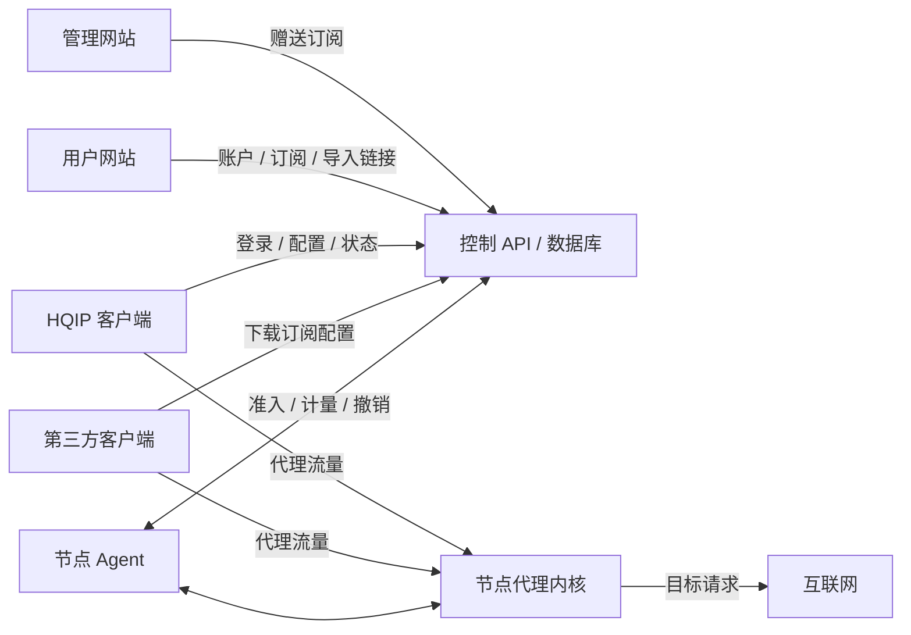

# 手动分配订阅的可靠性与链路复核

范围：管理后台给用户赠送订阅。用户已澄清本次不是节点安装或部署失败。修复经本地回归与完整 CI 验证后，已于 2026-11-22 发布生产；线上诊断与发布后业务数据核对均为只读操作。

## 观察与结论边界

2026-11-22 检查时线上版本为 `1f16b030488fd4e319ef3ebf4c8cd5ece279b127`。读取到的 36 次分配操作中，28 次返回 200（6–880 ms），7 次返回 400（5016–5214 ms），1 次返回 409。16 个活动节点均为 ready、核心健康，上报距检查时为 1–5 秒。读取 PostgreSQL 最近 8 小时、最多 12000 行日志的样本，统计到 4971 次序列化冲突、24 次锁等待超时。脱敏原始摘要位于库外诊断目录 `.diagnostics/manual-assignment-inspection.json` 和 `.diagnostics/manual-assignment-db-errors.json`。

约 5 秒失败与 `retryDatabase` 的重试预算一致，支持“事务争用导致重试耗尽”的判断；现有操作日志没有逐请求 SQLSTATE，不能把全部数据库错误归因于赠送，亦不能据此证明所有失败都同源。

## 链路职责与冗余

网站与控制 API 管理配置和权限，正常代理数据直接经过节点，不由网站转发。节点上 Reality 入口转入同机 HY2 授权/计量链路，使两种协议共用订阅额度、连接限制和账本；这是当前实现的职责复用，不应直接删除其中一层。原生客户端状态同步、第三方订阅下载与节点计量上报的消费者和用途不同，不能仅因均使用同一订阅就合并成一个请求。

本次确认并移除的冗余：

| 原行为 | 调整与原因 |
| --- | --- |
| 分配前读取全站在线身份映射，之后又用已分配用户数覆盖排名 | 候选资格只读候选节点健康及所属服务器容量；分配排名直接使用持有与预留人数，自动选点仍单独读取在线人数 |
| 新订阅写入事务内读取完整展示模型，包括实时租约/用量汇总 | 手动分配先提交业务状态，再读取回执；减少与实时计量的无关读写依赖 |
| 幂等重放重复写业务审计，HTTP 层另写一条赠送审计 | `subscription.assigned` 与新赠送在同一事务写一次；HTTP 访问/操作记录继续记录实际请求 |

## 恢复与一致性

保留 Serializable、用户锁、版本检查、模板启用检查、健康门槛、节点容量和同用户同模板不重叠分配规则，没有延长数据库重试预算或绕过库存。订阅、节点分配、用量账本、首周期、用户版本和业务审计原子提交。支付和旧申请审批复用的内部赠送包装继续在原事务内构造结果；本次提交后读取只用于管理员赠送入口。

响应丢失或数据库异常返回可恢复的 503。后台界面在发送前保存请求及确认快照，在当前标签页跨弹窗、刷新和重新登录恢复同一请求；最多自动尝试 3 次，失败后提供手动继续确认。401/普通 403 不释放待确认标识；只有明确业务拒绝才重新加载并允许新赠送。完整边界见 [接口契约](../interfaces.md) 和 [用户管理](../portal.md)。

局限：不同标签页、设备或不同管理员发起的新请求各自是独立赠送，不提供跨管理员“同一意图”去重。清理会话存储后应先核对已有订阅。网站/数据库高可用和节点备用数量未在此次修复中改变。

## 回归证据

- PostgreSQL 阻塞在线身份表：原实现在库存选择处触发 `55P03`，新实现正常分配，证明该读取已解除。
- PostgreSQL 注入提交后结果读取失败：新订阅已提交；用原请求及旧版本重试恢复同一订阅，分配、账本、首周期和审计均各一份。
- 并发实时租约写入与手动赠送、原请求恢复均通过；此用例原实现也能通过，作为并发回归，不作为单独根因复现。
- HTTP 覆盖身份/CSRF、参数拒绝、数据库异常 503 与脱敏、版本冲突、库存不足、停用、同请求重放及审计次数。
- 浏览器使用本地拦截夹具，覆盖“已提交但多次 503”、关闭/刷新恢复、轮询保留确认快照、冲突重新加载、成功后详情刷新失败、存储禁用、桌面与窄屏布局；没有调用线上写接口。

完成的检查：`go test -tags=with_utls ./internal/store ./internal/control`、同两包的 `go vet`，以及独立 PostgreSQL 18 测试库下 `-run 'Test(Subscription|Automatic|Postgres|Payment)' -count=1` 均通过。管理站构建、全部 24 个 Node 测试、赠送弹窗与既有节点编辑 Playwright 回归通过；重试间隔最终调整为 1 秒和 2 秒后重新构建并重跑赠送测试。构建仍有原有的 500 kB 分块大小提示。

GitNexus 已重新建索引并运行包含新增文件的 `detect-changes --scope all`（用临时 Git 索引纳入新文件，未改变实际暂存区）。变更检测未报 partial/truncated；共享 `api` 的影响风险为 CRITICAL，修改限于附加错误状态/代码和可选取消信号，不引入全局写请求重试。索引器本身仍提示全仓库执行流枚举存在默认预算截断，因此图谱不能证明未列出的调用不存在；相关接口路由和动态调用同时由文本核对及运行测试确认。既有客户端探测和导入样式改动保持原状，未纳入本次修复。

新增生产文件少于 300 行。原 `subscriptions.go` 的模板、旧申请、赠送职责已分别拆出；`Accounts.tsx` 只抽出本次修改的赠送弹窗，沿用项目对历史大文件逐步拆分的范围约定。完整发布同时包含控制端与管理站；实际失败率与延迟变化仍需后续操作日志确认，不能用本地测试代替生产业务样本。

## 生产发布与验收

- 发布提交：`945071939a855925d6f6ad59c158636282d1f455`；GitHub Actions 运行 `45029942351` 的测试、构建及部署全部成功。Linux 全量 race/vet、Windows 回归与干净打包、真实 PostgreSQL/Redis、支付幂等和三组真实客户端回归均通过。
- 生产服务于 **2026-11-22 14:03:15 UTC** 切换至该提交；14:03:53 UTC 验收时为 active/running，重启计数为 0。`current`、运行中的程序路径、程序 SHA-256、发布清单和客户端产物来源均与该提交一致。
- 发布前备份位于 `/root/backups/hqip-ci-945071939a855925d6f6ad59c158636282d1f455-45029942351-1`，含 `postgres.before.tar.gz` 与原服务/站点配置；状态为 `active`，前版本为 `1f16b030488fd4e319ef3ebf4c8cd5ece279b127`。备份及密钥留在服务器，未上传源码或 Actions。
- 两路本机 `/readyz`、公网用户站与管理站、公共 `/healthz` 和 `/readyz` 均返回 200，健康 JSON 为 `ok=true`。从服务器及操作端两个位置检查公网入口均通过。两个页面及其 JS/CSS 摘要匹配新发布清单；管理站包含本次请求恢复逻辑，运行程序包含新的可恢复错误契约。
- 16 个活动节点均 ready、核心健康、配置版本收敛，上报最大年龄为 5.4 秒。发布前后用户数 403、订阅数 151，未存在进行中的节点部署任务；本次没有更新节点 Agent/HY2，也没有新增测试赠送。
- 验收时新版启动后尚无新的手动分配操作，因此只确认生产版本、资源、就绪状态和节点同步正常；不宣称线上分配失败率已实测下降。提交后响应丢失及幂等恢复由真实 PostgreSQL、本地 HTTP 与浏览器回归覆盖。

验收同时修正了接口文档的域名描述：现网及 `deploy/nginx-hqip.conf` 使用 `hqip.sharevps.online` 承载 API，管理页面由 `cms-hqip.sharevps.online` 跨域调用；原文的 `api-hqip.sharevps.online` 未配置 DNS，不是本次部署引入的故障。公网 API 探针沿用正式部署脚本的 `Go-http-client/1.1` User-Agent。

脱敏证据保存在库外诊断目录：`manual-assignment-production-before.json`、`manual-assignment-production-after.json`、`manual-assignment-external-health.json`、`manual-assignment-ci-result.json`。本节与接口域名校正属于发布后的文档补记，不改变运行产物。
