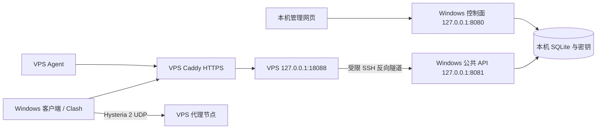

# 运维

正式部署已切换为独立服务器，当前操作以 [服务器部署与恢复](server-deployment.md) 为准。以下本地控制面与隧道章节保留为历史拓扑恢复参考，不应重新启动已退役服务。

## 本地控制面与公网入口

当前拓扑由 Windows 管理电脑运行控制面，管理员页面为 `http://127.0.0.1:8080`。VPS 保留 Caddy、Hysteria 和 Agent。公网域名只转发客户端、订阅、Agent 与健康检查，打开域名首页或管理员 API 返回 404 是预期行为。



两个控制面监听器都必须绑定回环地址，不能将 `8080` 管理端口加入转发。公网 API 本身不注册管理员路由，Caddy 同时使用路径白名单。隧道专用账号只能监听 VPS 的 `127.0.0.1:18088`，不能执行远程 shell 或建立任意转发；SSH 主机指纹严格固定。

本机断电、休眠或隧道断开时，公网登录、订阅和 Agent 上报暂时不可用；节点继续按最后成功配置服务并保留账本，恢复后自动补报。此时无法下发新的授权或撤销。需保持管理电脑运行和联网。

## 服务与日志

在仓库根目录运行：

```powershell
.\scripts\Start-HQIP.ps1
.\scripts\Stop-HQIP.ps1
.\scripts\Register-HQIPStartup.ps1
# 取消当前用户的登录自启动
.\scripts\Register-HQIPStartup.ps1 -Remove
```

这些脚本默认读取 `.local/controller/controller.json`，也接受 `-Config` 指定其他文件。启动脚本在后台维护控制面与 SSH 隧道，5 秒检查一次；退出后自动重启。日志位于配置中的 `stateDir/logs`，每份 stdout/stderr 日志限制 10 MiB 并保留一份轮转文件。自启动为当前用户登录触发，不保存 Windows 密码。

本机控制数据库与主密钥目录以 `controller.json` 的 `dataDir` 为准；不要误用已冻结的 VPS 数据库。迁移完成后 VPS 的旧 `hqip` 控制服务保持禁用，下列三个服务继续运行：

```sh
systemctl status hqip-caddy hqip-agent hqip-hysteria
journalctl --namespace=hqip -u hqip-caddy -n 100 --no-pager
journalctl --namespace=hqip -u hqip-agent -u hqip-hysteria -n 100 --no-pager
```

节点配置位于 `/etc/hqip-node`，Agent 账本 `/var/lib/hqip-agent/state.db`，Hysteria ACME 状态 `/var/lib/hqip-hysteria/acme`。旧服务器控制面数据库与主密钥保留在 `/var/lib/hqip` 用于回退，不再持续更新。这些目录和本机 `.local` 均不能放进代码仓库。

## 从服务器控制面迁移

`scripts/migrate_local.py` 分四步维护迁移状态。凭据文件包含服务器地址与密码两行；指纹必须事先核对。先构建当前 Windows 控制面及 Linux 节点发布产物，再执行：

```powershell
$migration = @('--credentials', 'C:\secure\server.txt', '--fingerprint', 'SHA256:已核对的服务器指纹', '--domain', 'testvps.sharevps.online')
uv run --with paramiko python scripts/migrate_local.py prepare @migration
uv run --with paramiko python scripts/migrate_local.py cutover @migration
.\scripts\Start-HQIP.ps1
uv run --with paramiko python scripts/migrate_local.py activate @migration
```

`prepare` 创建受限隧道账号、固定主机密钥和候选 Caddy 配置，不停止原控制服务。`cutover` 先冻结旧控制面，取得最终一致性备份并校验 SHA-256，再恢复到新的本机目录，确保迁移期间不会出现两个同时接受管理写入的控制面。`activate` 检查隧道健康和管理员接口隔离后才切换 Caddy，保留 HTTP ACME 转发及禁用 HTTP/3 的原设置。

切换后在本机登录，检查节点心跳、设备分配、真实代理、用量补报以及公网管理员路径 404，再注册登录自启动。`prepare` 不会覆盖已有准备状态，重试时应按 `controller.json` 的阶段继续。需要管理通道 SOCKS 代理时，`prepare` 可追加 `--socks 127.0.0.1:7897`；不要依赖即将被切换的 HQIP 连接作为唯一管理通道。

回退使用 `uv run --with paramiko python scripts/migrate_local.py rollback @migration`，恢复原 Caddy 和已冻结的服务器控制服务，随后停止本地监督进程。回退不会合并本机切换之后的新设备、授权或用量；回退前先保留当前本机备份，并核对差异。

## 备份与恢复

备份包含数据库一致性快照和加密主密钥，文件本身是秘密材料；丢失主密钥将无法恢复节点与订阅凭据。建议定期复制备份到独立的安全存储，本机磁盘上的备份不能防止整机丢失。

```powershell
$settings = Get-Content -Raw .local/controller/controller.json | ConvertFrom-Json
& $settings.binary backup --data-dir $settings.dataDir --output C:\secure\hqip-backup-YYYYMMDD.tar.gz
& $settings.binary restore --input C:\secure\hqip-backup-YYYYMMDD.tar.gz --data-dir C:\secure\hqip-restored
```

恢复只接受空目标目录，验证数据库完整性与密钥匹配。验证后运行 `Stop-HQIP.ps1`，保留原数据目录，更新 `controller.json` 的 `dataDir` 指向受当前 Windows 用户和 SYSTEM 保护的恢复目录，再运行 `Start-HQIP.ps1`。完整迁机时还需保护并转移本机隧道私钥、主机指纹和监督配置，保留节点账本及 Caddy/Hysteria 两套 ACME 数据。

恢复会重新应用备份中的设备启停状态、订阅令牌和连接密码：备份之后的停用或轮换不会自动保留，应按实际需要重新执行。恢复命令会清除旧浏览器会话，需重新登录；同时将节点期望配置版本提升到当前毫秒时间戳与原版本加一的较大值，重置已应用版本及心跳，避免仍运行的 Agent 因版本较新而拒绝同步。恢复前确认控制服务器时间正确，恢复后等待“待同步”消失，再检查设备与节点状态。

保留在节点上的 Agent 账本会在发现配置版本跳跃后重放历史；正常运行也每小时重放一次已确认记录。补报覆盖仍保留的最近 13 个月日累计和 7 天分钟数据，控制端按累计最大值和正差额合并，不会因重复上报叠加流量。原账本仍在时，这能补回控制数据库快照之后的用量；若账本也回退或丢失，则无法恢复双方都没有的数据。7 天以前缺失的小时曲线不能从日累计反推，已因队列上限压缩的分钟明细也不能恢复。恢复后应等待补报完成再核对统计。

## 连接验证

外部验证必须在代理节点以外的客户端网络运行，不能仅以 `systemctl active`、端口监听或同机请求判定节点可用。先创建并启用验证设备、显式分配待验证节点，再使用 `scripts/verify_external.py`：管理员凭据文件中的 `url` 指向本机管理入口；脚本从 `verification-config` 接口取得仅含候选节点、使用该设备真实凭据的配置，启动独立 Mihomo 实例，校验配置、TLS、出口 IP、代理上下行与设备计量后才调用管理员外部验证接口。节点变为 `ready` 后，脚本再次从公网地址下载正式订阅并验证连接。不会修改用户正在运行的 Clash 配置。

共享主机节点保留 `awaiting_external` 状态直到完成此验证；安装失败保留阶段日志，可输入 SSH 密码重试。节点网络不支持 UDP 时应维持验证失败状态。

## 常见排查

- **证书失败**：检查 A 记录、公网 TCP 80/443、CDN 是否关闭；同机需保留 Caddy 的 HTTP 挑战转发。不要开启 `skip-cert-verify` 规避问题。
- **网站正常但节点不通**：检查 UDP 节点端口及当前客户端网络。TCP 443 可用不代表 UDP 443 可用。
- **节点离线**：检查 Agent 服务及到控制台 HTTPS 的出站网络。已同步的凭据仍可在节点上鉴权，但撤销需待恢复同步。
- **公网域名返回 502**：检查本机控制面、SSH 隧道和电脑是否休眠；VPS `127.0.0.1:18088` 应连到本机公共 API `8081`。管理员首页公网返回 404 则正常。
- **设备显示待同步**：分别核对节点 Agent 授权版本与客户端配置版本。已处理版本追上后仍可能存在应用失败；旧节点移除仅以 Agent 的 `revoked` 确认为完成。
- **SSH 指纹变化**：立即停止重试并核对是否重装/更换服务器。系统不会自动忽略变化，当前界面不提供覆盖固定指纹的入口；需要先备份控制数据库，再由具备服务器管理权限的维护者处理原节点记录，不能用重复登记相同服务器规避检查。
- **额度超出仍可使用**：这是预期行为；额度仅展示和提醒，没有硬限速与断网策略。
- **流量短暂不刷新**：正常上报间隔 5 秒，统计 API 不清零；超过 30 秒会标记过期。控制恢复后自动补报，不手动重置内核计数。

## 升级

在本地测试后重新构建发布文件，备份数据，停止本地监督进程，将配置中的 Windows 控制二进制和 `artifactDir` 更新到新版本，再启动。控制面会执行版本化数据库迁移。不要对已完成本地迁移的 VPS 重新执行旧的服务器控制面引导脚本，否则会改变公网拓扑。

桌面客户端通过 `python scripts/build_desktop.py` 构建；退出托盘进程后更换完整包，保留 `%LOCALAPPDATA%\HQIP\Client` 中的用户数据。固定 sing-box 升级需同时更新构建摘要、客户端内核校验和 TUN 服务校验并重新验证。

节点二进制升级通过该节点的重试安装流程完成，需要重新提供 SSH 密码，原节点账本和证书保留。升级会短暂重启代理服务，完成后检查真实连接、Agent 配置版本和用量补报。
